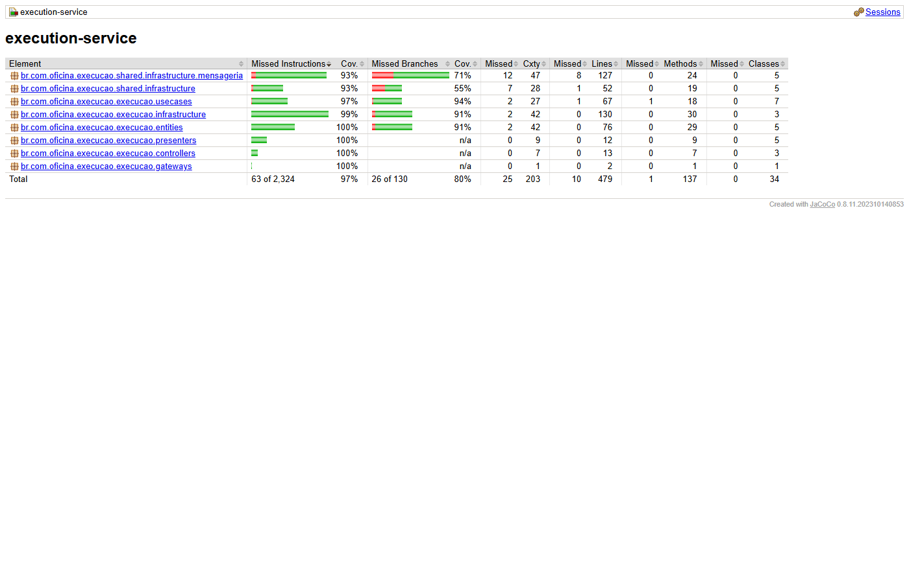

# Execution Service

[](https://sonarcloud.io/project/overview?id=olavowilke_soat-execution-service)
[](https://sonarcloud.io/project/overview?id=olavowilke_soat-execution-service)

Microsserviço da fila de execução de reparos da oficina (Tech Challenge FIAP, Fase 4).
Ele é um dos três serviços da Saga da OS. O OS Service orquestra a Saga e este serviço cuida do reparo, depois do pagamento.

## Propósito

- Aceita ou rejeita o serviço quando o OS Service pede (`IniciarExecucao`).
- Guarda a fila de execuções e o histórico de etapas de cada OS.
- Deixa o mecânico levar a execução pelas etapas `NA_FILA`, `EM_REPARO`, `EM_TESTE` e `CONCLUIDA`.
- Avisa o OS Service quando a execução termina (`ExecucaoFinalizada`).
- Tem uma flag de falha simulada, para mostrar a compensação da Saga na demo.

A arquitetura completa, a escolha da Saga e as tabelas de estados estão no
[README do OS Service](https://github.com/olavowilke/soat-oficina-api#fase-4--microsserviços-e-saga)
e na [ADR 0006](https://github.com/olavowilke/soat-oficina-api/blob/main/docs/adr/0006-microsservicos-e-saga-orquestrada.md).

## Etapas

```
NA_FILA → EM_REPARO → EM_TESTE → CONCLUIDA
                  ↑___________↓  (EM_TESTE pode voltar para EM_REPARO)
REJEITADA  (estado final de um serviço recusado)
```

## Endpoints

O contexto da aplicação é `/api/execucao`. As rotas de equipe **não** passam pelo API Gateway.
A equipe usa `kubectl port-forward -n execucao svc/execution-service 8080:8080`.

| Método | Caminho | Quem chama | Acesso |
|---|---|---|---|
| `GET` | `/fila` | Mecânico. Lista as execuções ativas, da mais antiga para a mais nova | Port-forward |
| `GET` | `/ordens/{osId}` | Mecânico. Detalhe e histórico da execução (404 se não existe) | Port-forward |
| `POST` | `/ordens/{osId}/etapa` | Mecânico. Corpo `{"etapa": "EM_REPARO"}`. `CONCLUIDA` envia `ExecucaoFinalizada`. 409 em transição inválida | Port-forward |
| `PUT` | `/admin/simulacao-falha` | Demo. Corpo `{"ativa": true}`. Resposta 204 | Port-forward |
| `GET` | `/actuator/health` | Gateway, smoke test do CD e Kubernetes | Gateway, rota pública |
| `GET` | `/actuator/prometheus` | `nri-bundle` (New Relic) | Só dentro do cluster |
| `GET` | `/swagger-ui/index.html`, `/v3/api-docs` | Pessoas | Gateway, rota pública |

Não existe `GET` para a flag de falha simulada.

### Swagger

As rotas de equipe não passam pelo gateway. O botão "Try it out" só funciona nelas por port-forward.

Pelo API Gateway:

```
$API/api/execucao/swagger-ui/index.html
$API/api/execucao/v3/api-docs
```

`$API` é o endpoint do API Gateway (SSM `/oficina/homolog/gateway/endpoint`).
Local: `http://localhost:8080/api/execucao/swagger-ui.html`, que redireciona para `swagger-ui/index.html`.

## Mensagens

Execution consome `oficina-homolog-execution-commands` e publica em `oficina-homolog-os-saga-replies`.
Todas as mensagens usam o envelope `MensagemSaga`: `messageId`, `sagaId`, `osId`, `type`, `correlationId`, `occurredAt` e `payload`.
Os atributos SQS `type`, `correlationId` e `newrelic` repetem os dados de rastreio.

### Entrada

| `type` | Campos do `payload` | O que o Execution faz |
|---|---|---|
| `IniciarExecucao` | `servicos[]` (`descricao`, `quantidade`), `observacoes` (pode ser `null`) | Cria a execução em `NA_FILA`, ou rejeita |

### Saída

| `type` | Campos do `payload` | Quando |
|---|---|---|
| `ExecucaoAceita` | `execucaoId` | O serviço entrou na fila |
| `ExecucaoRejeitada` | `motivo` (`SIMULACAO` ou `CAPACIDADE`) | A flag de falha estava ligada, ou há `EXECUCAO_CAPACIDADE_MAXIMA` execuções ativas |
| `ExecucaoFinalizada` | `execucaoId`, `finalizadaEm` | A etapa `CONCLUIDA` foi alcançada |

### Garantias

- **Idempotência.** A escrita inicial usa condição no DynamoDB. Uma entrega repetida de `IniciarExecucao` repete a resposta da primeira, nunca cria outra execução.
- **Avanço seguro.** O avanço de etapa compara o campo `versao`. Dois avanços ao mesmo tempo geram 409.
- **Rastreio.** O consumidor aceita o cabeçalho `newrelic` com `TransportType.Other`. O `newrelic-api` 8.16.0 não tem `TransportType.Queue`.
- **DLQ.** A fila `oficina-homolog-execution-commands-dlq` recebe a mensagem após 3 entregas sem sucesso.

## Banco de dados

DynamoDB em modo sob demanda, tabela única `oficina-homolog-execucoes`. A [ADR 0008](https://github.com/olavowilke/soat-oficina-api/blob/main/docs/adr/0008-dynamodb-na-execucao.md) explica a escolha.

| Item | `pk` | `sk` | Conteúdo |
|---|---|---|---|
| Execução da OS | `EXEC#<osId>` | `META` | Etapa, serviços, observações, motivo de rejeição, `versao` e lista `historico` de etapas |
| Falha simulada | `CONFIG` | `SIMULACAO_FALHA` | Flag `ativa` |

O índice `gsi-etapa` (`gsi1pk = ETAPA#<etapa>`, `gsi1sk` = data de criação) lista as execuções por etapa.
Nenhum outro serviço acessa esta tabela.

## Como rodar localmente

Pré-requisitos: Java 21, Docker, AWS CLI e o `./mvnw` do repositório.

```bash
export AWS_ACCESS_KEY_ID=test AWS_SECRET_ACCESS_KEY=test   # chaves falsas do LocalStack
docker compose up -d          # LocalStack com SQS e DynamoDB

# Cria a tabela (o LocalStack começa vazio)
aws --endpoint-url http://localhost:4566 --region us-east-1 dynamodb create-table \
  --table-name oficina-homolog-execucoes --billing-mode PAY_PER_REQUEST \
  --attribute-definitions AttributeName=pk,AttributeType=S AttributeName=sk,AttributeType=S \
                          AttributeName=gsi1pk,AttributeType=S AttributeName=gsi1sk,AttributeType=S \
  --key-schema AttributeName=pk,KeyType=HASH AttributeName=sk,KeyType=RANGE \
  --global-secondary-indexes 'IndexName=gsi-etapa,KeySchema=[{AttributeName=gsi1pk,KeyType=HASH},{AttributeName=gsi1sk,KeyType=RANGE}],Projection={ProjectionType=ALL}'

SPRING_CLOUD_AWS_ENDPOINT=http://localhost:4566 ./mvnw -s settings.xml spring-boot:run
```

A aplicação sobe em `http://localhost:8080/api/execucao`.
O listener cria a fila de comandos vazia no LocalStack.
A DLQ não nasce sozinha. O job de métricas avisa no log e segue.

| Variável | Padrão | Para quê |
|---|---|---|
| `EXECUCAO_DYNAMODB_TABELA` | `oficina-homolog-execucoes` | Nome da tabela |
| `EXECUCAO_FILAS_COMANDOS` | `oficina-homolog-execution-commands` | Fila de entrada |
| `EXECUCAO_FILAS_COMANDOS_DLQ` | `oficina-homolog-execution-commands-dlq` | DLQ lida pelas métricas |
| `EXECUCAO_FILAS_RESPOSTAS` | `oficina-homolog-os-saga-replies` | Fila das respostas |
| `EXECUCAO_CAPACIDADE_MAXIMA` | `20` | Execuções ativas antes de rejeitar por `CAPACIDADE` |
| `SPRING_PROFILES_ACTIVE` | `dev` | Perfil |
| `AWS_REGION` | `us-east-1` | Região |

Na AWS, o pod usa o EKS Pod Identity. Nenhuma chave estática existe.

## Testes e cobertura

```bash
./mvnw -s settings.xml verify    # precisa do Docker (Testcontainers com LocalStack)
```

- A suíte tem testes unitários, testes de integração (com LocalStack: SQS e DynamoDB) e o ArchUnit.
- O JaCoCo falha o build se a cobertura de linhas do conjunto ficar abaixo de 80%.
- Relatório JaCoCo local: `target/site/jacoco/index.html`, depois de `./mvnw verify`.
- Cobertura no Sonar: [](https://sonarcloud.io/project/overview?id=olavowilke_soat-execution-service)

Última medição (`./mvnw verify` no HEAD da branch `feat/fase4-metricas`): **98% das linhas (469 de 479) e 97% das instruções**.



## Deploy

O fluxo vive em `.github/workflows/`.

1. **CI** (PR e push em `main`). Jobs: `build-and-test` (`mvn verify` e Sonar), `owasp`, `Terraform fmt e validate` e `Validar manifestos Kubernetes (kustomize)`.
2. **Branch protegida.** `main` exige PR e o check `build-and-test`. Os jobs `owasp`, `Terraform fmt e validate` e `Validar manifestos Kubernetes (kustomize)` são informativos.
3. **CD** (push em `main`). Só roda se a variável `DEPLOY_HOMOLOG` for `true`.
   - Job `terraform`: cria fila e DLQ, tabela DynamoDB, ECR, role do pod, listener do NLB (porta 8082) e rotas do gateway.
   - Job `build-and-deploy`: cria o Secret `execution-service-secrets`, envia a imagem `sha-<git sha>` ao ECR, aplica `k8s/overlays/homolog`, espera o rollout e chama `/api/execucao/actuator/health` pelo gateway.

| Nome | Tipo | Para quê |
|---|---|---|
| `AWS_DEPLOY_ROLE_ARN`, `TF_STATE_BUCKET`, `TF_LOCK_TABLE` | Secret | Acesso AWS por OIDC e estado do Terraform |
| `NEW_RELIC_LICENSE_KEY` | Secret | Agente Java do New Relic. Vazio, o agente não liga |
| `DEPLOY_HOMOLOG` | Variable | Precisa ser `true` para o CD rodar |
| `AWS_REGION` | Variable | Opcional. O padrão é `us-east-1` |
| `SONAR_TOKEN` | Secret | Sem ele, o passo Sonar é pulado. Precisa da conta SonarCloud |
| `SONAR_ORGANIZATION` | Variable | Organização do SonarCloud |
| `NVD_API_KEY` | Secret | Chave gratuita da NVD. Sem ela, o job `owasp` é pulado |

## Operação

- **Métricas.** `/actuator/prometheus` expõe `oficina_fila_dlq_mensagens{fila}`. O `nri-bundle` coleta pelas anotações do pod.
  O alerta "Saga - mensagens em DLQ" abre quando o valor passa de 0 por 5 minutos.
- **Logs.** Logs JSON com `correlationId` e `sagaId`. Busque pelo `sagaId` no New Relic para seguir uma OS.
- **Mensagem na DLQ.** Leia a mensagem na DLQ, corrija a causa e reenvie à fila de comandos. O reprocessamento é manual.
- **Falha simulada.** `PUT /api/execucao/admin/simulacao-falha` com `{"ativa": true}` faz o próximo `IniciarExecucao` responder `ExecucaoRejeitada` (`SIMULACAO`).
  O serviço desliga a flag sozinho depois dessa rejeição. Antes de gravar a demo, envie `{"ativa": false}`.
- **Repetir `CONCLUIDA`.** Se a execução já terminou, `POST /ordens/{osId}/etapa` com `CONCLUIDA` reenvia `ExecucaoFinalizada`. Use se a resposta se perdeu.

### Limites conhecidos

- **Sem autenticação própria.** As rotas de equipe não passam pelo gateway. O acesso é só por port-forward.
- **Sem timeout de execução.** Uma execução parada em `EM_REPARO` fica assim até alguém avançar a etapa.
- **Capacidade fixa.** `EXECUCAO_CAPACIDADE_MAXIMA` conta as execuções ativas pela consulta ao índice. Não há reserva de vaga.
